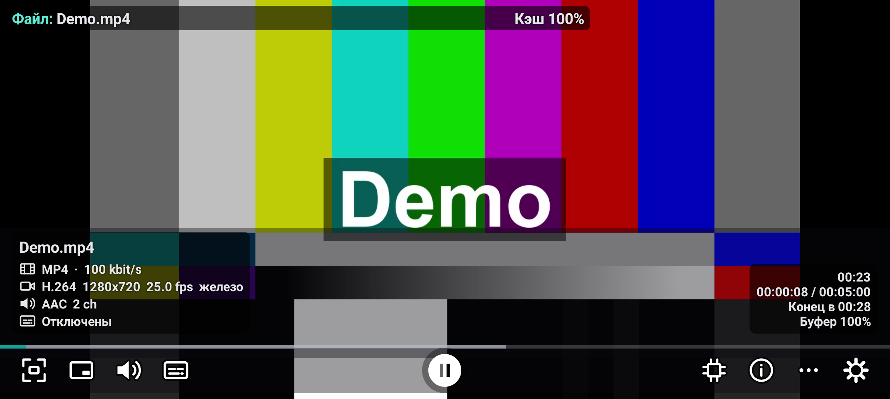
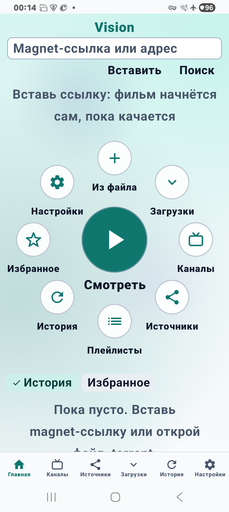
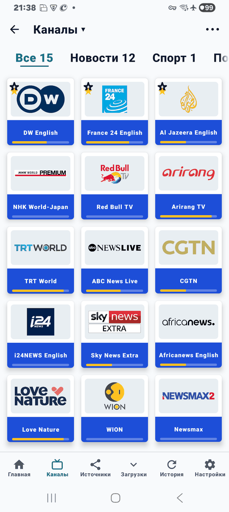
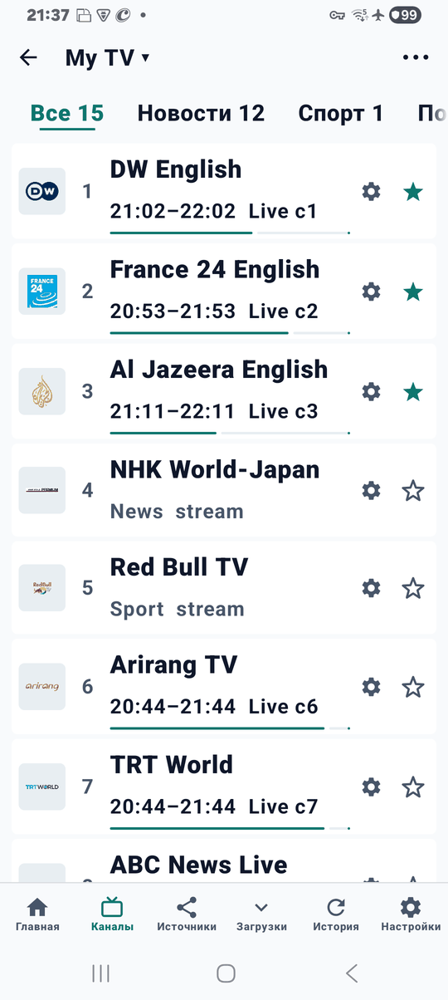
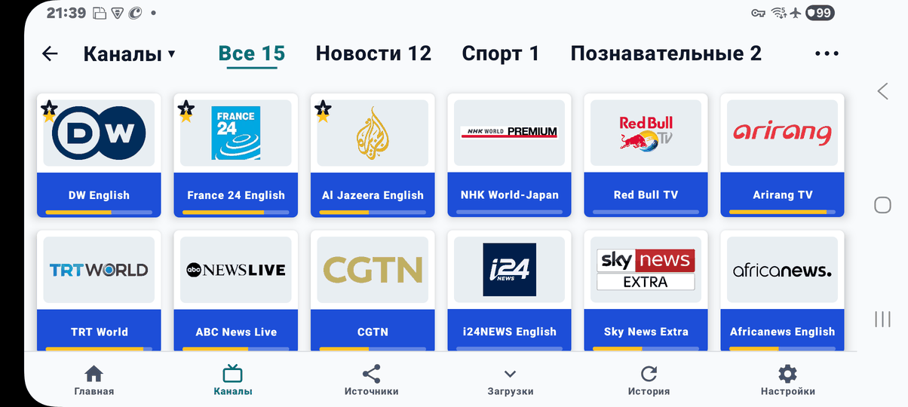
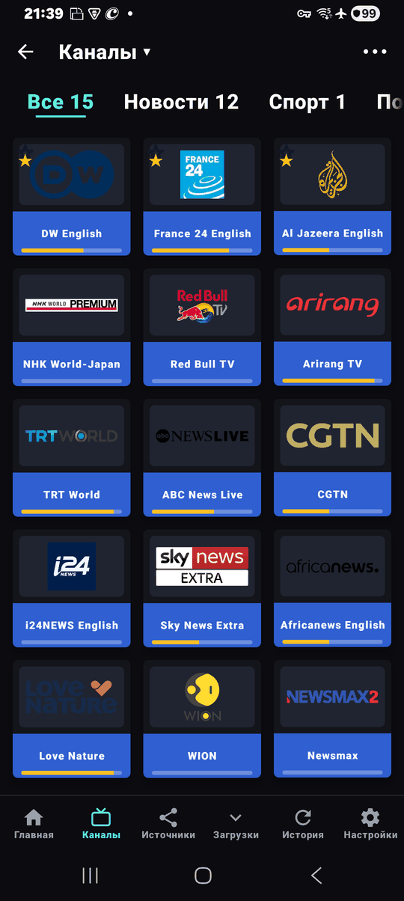

[English](README.md) · [Русский](README.ru.md) · [Українська](README.uk.md)

🌐 All our programs: https://drugoj00.github.io/ · Telegram channel: https://t.me/PhoneInWindowSound

# Vision

**Vision contains no video or audio content and no links to content.** **Screenshots are shown solely to demonstrate the app's features: the channels in them are not included in Vision, users add their own playlists.**

Media player for Android phones and TV boxes: torrents, IPTV playlists of your own, network folders, auto volume. Own engine, no ads.

Vision plays video, audio and TV channels from files, links, playlists, network folders (SMB, WebDAV, DLNA, FTP, SFTP) and torrents, with playback while downloading. Add your own playlist (a link or an M3U, M3U8, XSPF or PLS file) and the channels appear as tiles with logos. Auto Volume keeps the sound even and tames loud commercials. Paste a link, open a file or a playlist, press play.

**Vision provides no content. The user is responsible for complying with the copyright laws of their country.**

⭐ If the app is useful, please star this repository: it costs nothing and helps other people find it.

## Download

**Version 2.0.** [Vision-2.0.apk](https://github.com/drugoj00/vision/releases/download/v2.0/Vision-2.0.apk) · [Releases](https://github.com/drugoj00/vision/releases)

SHA-256: `e717f76c610eab8633a5d7c21286532cd703739e2a221f22ce055af14fcc5594`

Not on Google Play: download the APK here. Android may warn about installing from an unknown source.

## What's new in 2.0

- Playlist wizard: add a link or a file from a phone by a QR code
- Smooth work: channel tiles scroll without stutter, logos load in the background

## What was new in 1.0

- Channels as tiles with logos: 3 columns or more in portrait and 6 or more in landscape on phones; add your own playlist by link or from a file
- "Window": own floating window (move, resize, remote control)
- "Hardware+" decoder: AC3, E-AC3, DTS passthrough, video in software when the box cannot handle it
- Compact player panel: buttons are configurable, the rest go to the menu
- Player panel with adjustable transparency, text on its own backing
- Panel text size is adjustable; text is thinner and smaller
- Bottom tab bar on phones: Home, Channels, Sources, Downloads, History, Settings
- Torrents by magnet or .torrent, playback while downloading; episodes with watch progress and auto-play of the next one
- Auto Volume: TV mode cuts loud commercials
- Own downloader: HTTP(S) links and torrents (magnet, .torrent) into a chosen folder, file selection, queue, pause and resume, speed limit
- Playlist wizard: step-by-step adding for beginners (link, file, archive, clipboard, list of addresses)
- Playlists from archives (ZIP, GZ…) are added by themselves
- Passthrough sound "RAW via PCM" and "Convert to AC3" for receivers
- IPTV playlists, favorites, search, TV guide, a mark on dead channels, own playlists with an editor
- Sources: SMB, WebDAV, DLNA, FTP, SFTP and device folders
- Swipe gestures, A-B repeat, bookmarks, speed 0.25-4x, "What's new" window on update
- Settings in groups with search, backup and restore; Russian, Ukrainian and English, light, dark and black themes

## Features

- **Torrents.** A magnet link, a .torrent file or link, or "Share" from another app. The file list comes first, then only the chosen file is downloaded, in a window around the playback position. Seek anywhere.
- **Series.** Watch progress bar, "Continue" and auto-play of the next episode.
- **Player.** Media3 with external subtitles (.srt, .ass, .vtt), audio and subtitle tracks, screen size modes, speed 0.25-4x, A-B repeat, bookmarks, picture rotation, volume gain up to 200%, swipe gestures, sleep timer. A compact control panel with configurable buttons. Remote, touch and mouse.
- **Window.** The video over other apps in an own floating window with move, resize and remote control.
- **Decoders.** "Auto", "Hardware", "Hardware+" (AC3, E-AC3, DTS passthrough, video in software if the box cannot handle it) and "Software"; AV1.
- **Auto Volume.** A TV mode that tames loud commercials; a switch in settings and in the Audio panel.
- **IPTV.** M3U, M3U8, XSPF and PLS playlists, groups, favorites, search, an XMLTV guide, a mark on dead channels; channels as tiles with logos or a list (3 columns or more in portrait and 6 or more in landscape on phones); own playlists with an editor.
- **Sources.** SMB, WebDAV, DLNA, FTP, SFTP and device folders; "Video" and "Audio" collections.
- **Downloads.** Torrents and files by links into a chosen folder.
- **Engine.** Speed limits, connections, port, DHT and LSD, mobile network, buffer ahead, cache on device memory or an external drive.
- **Phones, TV boxes and car head units.** Touch, mouse and remote control; a large interface on big screens.
- **Settings.** Nine groups with search, full backup and restore. Russian, Ukrainian and English; light, dark and black themes.
- **Updates.** Update check on GitHub with a file check and a "What's new" window.

## Requirements and limits

- Android 6.0 or newer (ARMv7, ARM64, x86_64). Permissions: network, notifications (Android 13 and newer), start at boot.
- Internet is needed for torrents and IPTV. In countries that prohibit torrents they are blocked until confirmation; the country is detected offline. NFS is not supported.
- Software AV1 on weak boxes: 720p plays smoothly, 1080p drops frames, 4K is too heavy.
- The floating window needs "Display over other apps".
- Tested on an Android 15 phone and a TV box. Not verified: car head units, Stalker portals, TV guide archives (zip, JTV), reminders, external-drive cache, Dolby/DTS passthrough on real HDMI equipment.

## Screenshots

Taken in the light theme; the interface language in them is Russian.

  

 

## License

Proprietary license, see [LICENSE](LICENSE): all rights reserved; free for personal use, no ads; redistribution only in the original unmodified form with the author named. Third-party libraries keep their own licenses: libtorrent4j (MIT), libtorrent (BSD-3), Media3 (Apache-2.0), FFmpeg (LGPL-2.1+). The demo video in the screenshots is "Big Buck Bunny" by Blender Foundation (CC BY 3.0); the torrent in the screenshots is "Sintel" (CC BY 3.0).
