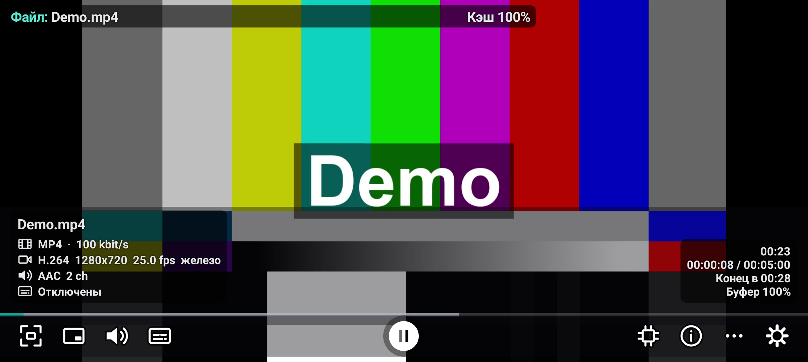
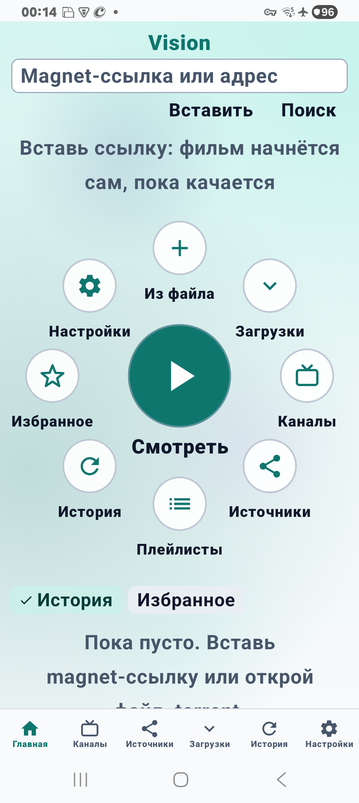
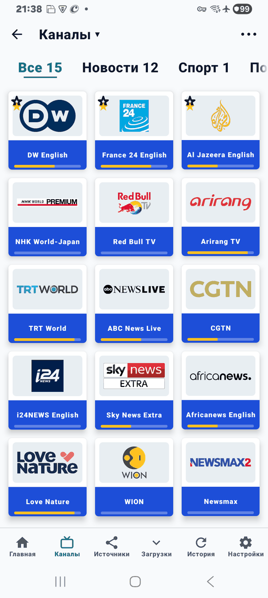
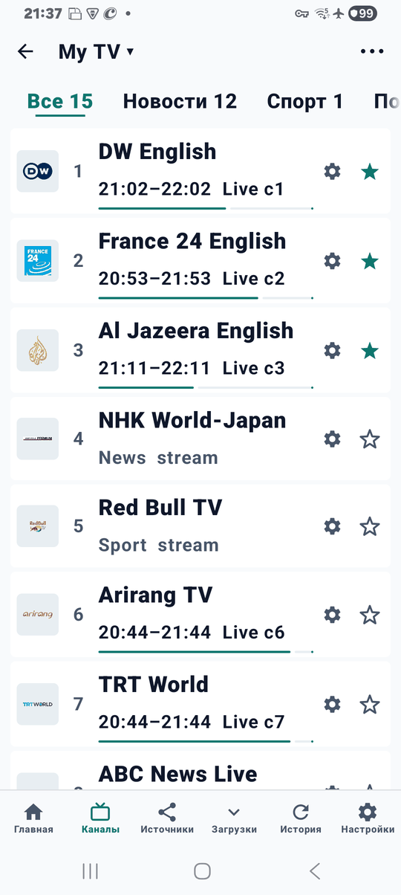
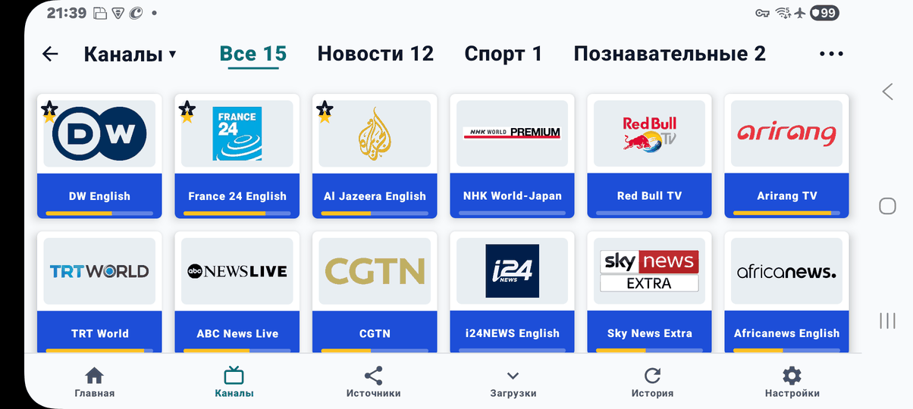
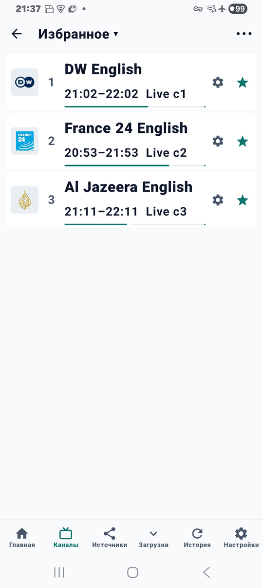
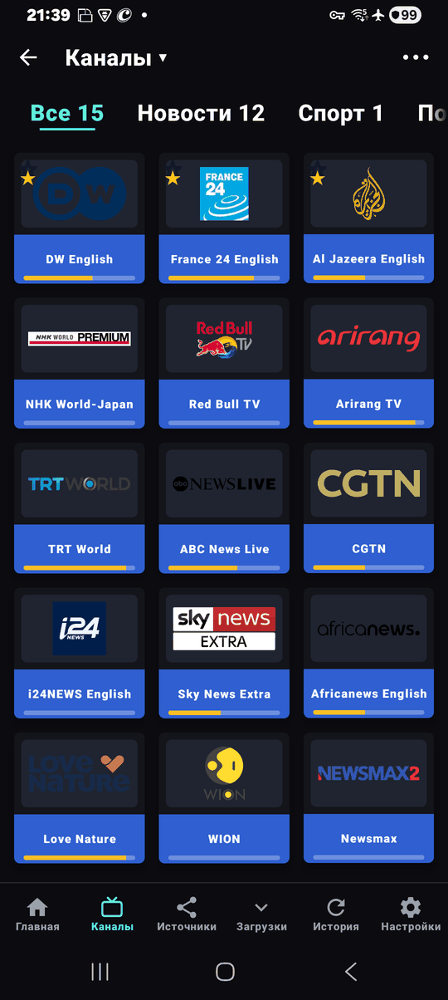

[English](README.md) · [Русский](README.ru.md) · [Українська](README.uk.md)

🌐 Все наши программы: https://drugoj00.github.io/ · Telegram-канал: https://t.me/PhoneInWindowSound

# Vision

**Внимание! Vision не содержит видео и аудио контента, а также ссылок на контент.** **Скриншоты приведены исключительно для демонстрации возможностей программы: каналов из скриншотов в Vision нет, пользователь добавляет свои плейлисты сам.**

Медиаплеер для телефонов и ТВ-приставок на Android: торренты, IPTV со своими плейлистами, сетевые папки, автогромкость. Свой движок, без рекламы.

Vision воспроизводит видео, звук и ТВ-каналы из файлов, ссылок, плейлистов, сетевых папок (SMB, WebDAV, DLNA, FTP, SFTP) и торрентов, в том числе во время загрузки. Добавь свой плейлист (ссылку или файл M3U, M3U8, XSPF, PLS), и каналы появятся плитками с логотипами. Автогромкость выравнивает звук и усмиряет громкую рекламу. Вставь ссылку, открой файл или плейлист, нажми «Смотреть».

**Программа не предоставляет контент. Пользователь отвечает за соблюдение законов своей страны об авторском праве.**

⭐ Если программа пригодилась, поставь звезду этому репозиторию: это бесплатно и помогает другим её найти.

## Скачать

**Версия 1.0.** [Vision-1.0.apk](https://github.com/drugoj00/vision/releases/download/v1.0/Vision-1.0.apk) · [Releases](https://github.com/drugoj00/vision/releases)

SHA-256: `07e2a8de0a9dd523264761fdf20a9ee684b9241a35c28830130134d7cd2bc475`

Нет в Google Play: скачай APK здесь. Android может предупредить об установке из неизвестного источника.

## Что нового в 1.0

- Каналы плитками с логотипами: на телефоне от 3 колонок в портрете и от 6 в ландшафте; свой плейлист по ссылке или из файла
- «Окно»: «картинка в картинке», а где её нет, собственное плавающее окно (перемещение, размер, пульт)
- Декодер «Аппаратный+»: сквозной звук AC3, E-AC3, DTS, видео программно, если приставка его не тянет
- Компактная панель плеера: кнопки настраиваются, лишние убраны в меню
- Прозрачная панель плеера с регулировкой, буквы на своей подложке
- Размер текста панели настраивается, текст тоньше и меньше
- Нижняя панель вкладок на телефоне: Главная, Каналы, Источники, Загрузки, История, Настройки
- Загрузки: торренты и файлы по ссылкам в выбранную папку
- Торренты по magnet и .torrent, просмотр во время загрузки; серии с полоской просмотра и автопереходом
- Автогромкость: ТВ-режим срезает громкую рекламу
- IPTV-плейлисты, избранное, поиск, программа передач, пометка нерабочих каналов, свои плейлисты с редактором
- Источники: SMB, WebDAV, DLNA, FTP, SFTP и папки устройства
- Жесты свайпом, повтор A-B, закладки, скорость 0,25-4×, окно «Что нового» при обновлении
- Настройки по группам с поиском, резервная копия и восстановление; русский, украинский и английский, светлая, тёмная и чёрная темы

## Возможности

- **Торренты.** Magnet-ссылка, файл или ссылка на .torrent, «Поделиться» из другого приложения. Сначала список файлов, потом качается только выбранный файл в окне вокруг места просмотра. Перемотка в любое место.
- **Серии.** Полоска просмотра, «Продолжить» и автопереход к следующей серии.
- **Плеер.** Media3: внешние субтитры (.srt, .ass, .vtt), выбор аудио- и субтитровых дорожек, размер кадра, скорость 0,25-4×, повтор A-B, закладки, поворот и зеркало картинки, усиление громкости до 200%, жесты свайпом, таймер сна. Компактная панель управления с настраиваемыми кнопками. Пульт, касание и мышь.
- **Окно.** Видео поверх других приложений: «картинка в картинке», а где её нет, собственное плавающее окно с перемещением, размером и управлением пультом.
- **Декодеры.** «Авто», «Аппаратный», «Аппаратный+» (сквозной звук AC3, E-AC3, DTS, а видео программно, если приставка его не тянет) и «Программный»; AV1.
- **Автогромкость.** ТВ-режим, который усмиряет громкую рекламу; выключатель в настройках и в панели «Аудио».
- **IPTV.** Плейлисты M3U, M3U8, XSPF и PLS, группы, избранное, поиск, программа передач XMLTV, пометка нерабочих каналов; каналы плитками с логотипами или списком (на телефоне от 3 колонок в портрете и от 6 в ландшафте); свои плейлисты с редактором.
- **Источники.** SMB, WebDAV, DLNA, FTP, SFTP и папки устройства; коллекции «Видео» и «Аудио».
- **Загрузки.** Торренты и файлы по ссылкам в выбранную папку.
- **Движок.** Лимиты скорости, соединения, порт, DHT и LSD, мобильная сеть, запас вперёд, кэш в памяти устройства или на внешнем накопителе.
- **Телефоны, ТВ-приставки и автомагнитолы.** Касание, мышь и пульт; крупный интерфейс на больших экранах.
- **Настройки.** Девять групп с поиском, полная резервная копия и восстановление. Русский, украинский и английский; светлая, тёмная и чёрная темы.
- **Обновления.** Проверка обновлений на GitHub с проверкой файла и окном «Что нового».

## Требования и ограничения

- Android 6.0 и новее (ARMv7, ARM64, x86_64). Права: сеть, уведомления (Android 13 и новее), запуск при включении.
- Для торрентов и IPTV нужен интернет. В странах с запретом торренты блокируются до подтверждения; страна определяется без интернета. NFS не поддерживается.
- Программный AV1 на слабых приставках: 720p плавно, 1080p с пропусками кадров, 4K не тянет.
- Для плавающего окна нужно разрешение «Поверх других приложений»; «картинка в картинке» работает там, где её поддерживает система.
- Проверено на телефоне с Android 15 и на ТВ-приставке. Не проверено: автомагнитолы, порталы Stalker, архивы программы передач (zip, JTV), напоминания, кэш на внешнем накопителе, проброс Dolby/DTS на настоящей HDMI-технике.

## Скриншоты

Сняты на светлой теме.

  

 

  

## Лицензия

Собственная лицензия, см. [LICENSE](LICENSE): все права защищены; бесплатно для личного использования, без рекламы; распространять можно только в неизменном виде с указанием автора. Сторонние библиотеки остаются под своими лицензиями: libtorrent4j (MIT), libtorrent (BSD-3), Media3 (Apache-2.0), FFmpeg (LGPL-2.1+). Демо-видео на скриншотах: «Big Buck Bunny», Blender Foundation (CC BY 3.0); торрент на скриншотах: «Sintel» (CC BY 3.0).
