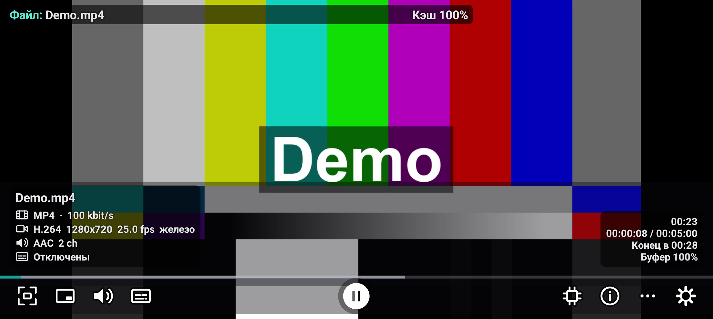
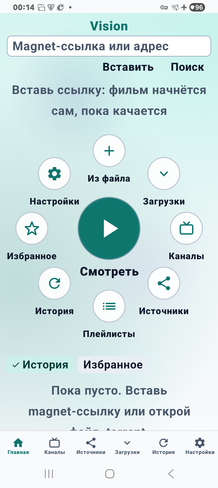
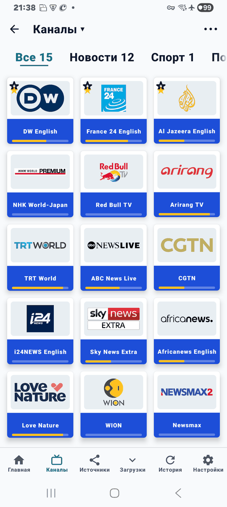
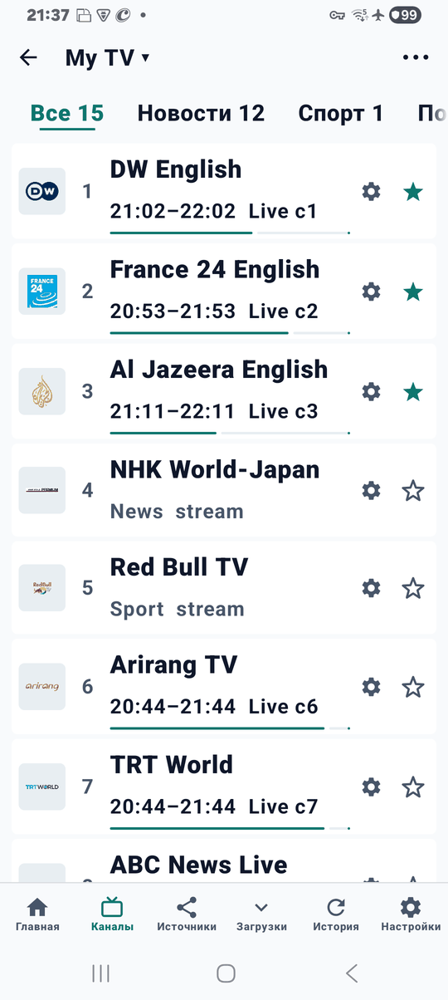
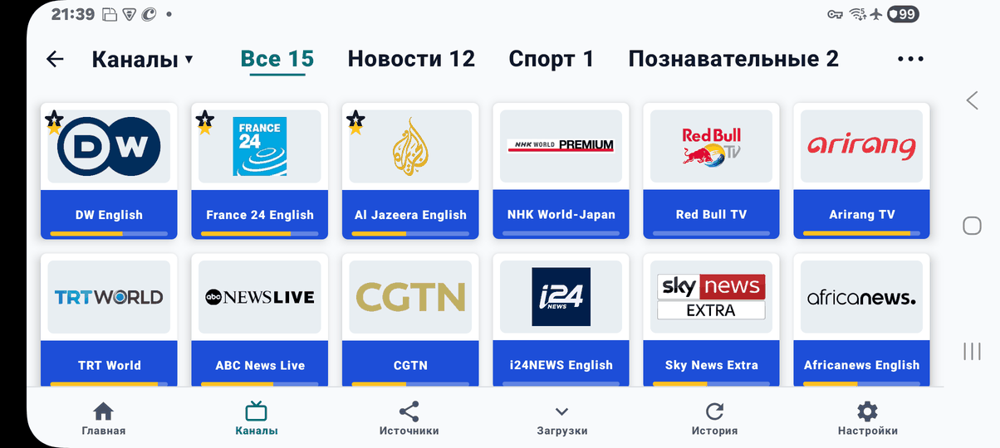
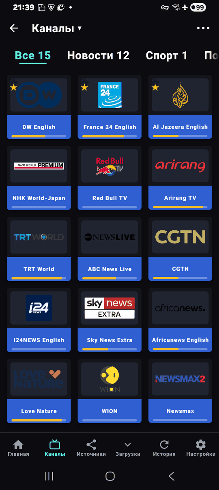

[English](README.md) · [Русский](README.ru.md) · [Українська](README.uk.md)

🌐 Усі наші програми: https://drugoj00.github.io/ · Telegram-канал: https://t.me/PhoneInWindowSound

# Vision

**Увага! Vision не містить відео й аудіо контенту, а також посилань на контент.** **Скриншоти наведені виключно для демонстрації можливостей програми: каналів зі скриншотів у Vision немає, користувач додає власні плейлісти сам.**

Медіаплеєр для телефонів і ТБ-приставок на Android: торенти, IPTV зі своїми плейлистами, мережеві теки, автогучність. Власний рушій, без реклами.

Vision відтворює відео, звук і ТБ-канали з файлів, посилань, плейлистів, мережевих тек (SMB, WebDAV, DLNA, FTP, SFTP) і торентів, зокрема під час завантаження. Додай свій плейлист (посилання або файл M3U, M3U8, XSPF, PLS), і канали зʼявляться плитками з логотипами. Автогучність вирівнює звук і вгамовує гучну рекламу. Встав посилання, відкрий файл або плейлист, натисни «Дивитися».

**Програма не надає вміст. Користувач відповідає за дотримання законів своєї країни про авторське право.**

⭐ Якщо програма стала в пригоді, постав зірку цьому репозиторію: це безкоштовно й допомагає іншим її знайти.

## Завантажити

**Версія 1.0.** [Vision-1.0.apk](https://github.com/drugoj00/vision/releases/download/v1.0/Vision-1.0.apk) · [Releases](https://github.com/drugoj00/vision/releases)

SHA-256: `c4d074123dd484afc2caa25511ae49ad6b7adfe6f03f61508451c0f68c27dacb`

Немає в Google Play: завантаж APK тут. Android може попередити про встановлення з невідомого джерела.

## Що нового в 1.0

- Канали плитками з логотипами: на телефоні від 3 колонок у портреті й від 6 в альбомній орієнтації; власний плейлист за посиланням або з файлу
- «Вікно»: «картинка в картинці», а де її немає, власне плаваюче вікно (переміщення, розмір, пульт)
- Декодер «Апаратний+»: наскрізний звук AC3, E-AC3, DTS, відео програмно, якщо приставка його не тягне
- Компактна панель плеєра: кнопки налаштовуються, зайві сховано в меню
- Нижня панель вкладок на телефоні: Головна, Канали, Джерела, Завантаження, Історія, Налаштування
- Завантаження: торенти й файли за посиланнями у вибрану теку
- Торенти за magnet і .torrent, перегляд під час завантаження; серії зі смужкою перегляду й автопереходом
- Автогучність: ТБ-режим зрізає гучну рекламу
- IPTV-плейлисти, обране, пошук, телепрограма, позначка неробочих каналів, власні плейлисти з редактором
- Джерела: SMB, WebDAV, DLNA, FTP, SFTP і теки пристрою
- Жести свайпом, повтор A-B, закладки, швидкість 0,25-4×, вікно «Що нового» під час оновлення
- Налаштування за групами з пошуком, резервна копія й відновлення; українська, російська й англійська, світла, темна й чорна теми

## Можливості

- **Торенти.** Magnet-посилання, файл або посилання на .torrent, «Поділитися» з іншого застосунку. Спершу список файлів, потім завантажується лише вибраний файл у вікні навколо місця перегляду. Перемотування в будь-яке місце.
- **Серії.** Смужка перегляду, «Продовжити» й автоперехід до наступної серії.
- **Плеєр.** Media3: зовнішні субтитри (.srt, .ass, .vtt), вибір аудіо- й субтитрових доріжок, розмір кадру, швидкість 0,25-4×, повтор A-B, закладки, поворот і дзеркало картинки, підсилення гучності до 200%, жести свайпом, таймер сну. Компактна панель керування з кнопками, що налаштовуються. Пульт, дотик і миша.
- **Вікно.** Відео поверх інших застосунків: «картинка в картинці», а де її немає, власне плаваюче вікно з переміщенням, розміром і керуванням пультом.
- **Декодери.** «Авто», «Апаратний», «Апаратний+» (наскрізний звук AC3, E-AC3, DTS, а відео програмно, якщо приставка його не тягне) і «Програмний»; AV1.
- **Автогучність.** ТБ-режим, що вгамовує гучну рекламу; вимикач у налаштуваннях і в панелі «Аудіо».
- **IPTV.** Плейлисти M3U, M3U8, XSPF і PLS, групи, обране, пошук, телепрограма XMLTV, позначка неробочих каналів; канали плитками з логотипами або списком (на телефоні від 3 колонок у портреті й від 6 в альбомній орієнтації); власні плейлисти з редактором.
- **Джерела.** SMB, WebDAV, DLNA, FTP, SFTP і теки пристрою; добірки «Відео» й «Аудіо».
- **Завантаження.** Торенти й файли за посиланнями у вибрану теку.
- **Рушій.** Ліміти швидкості, з’єднання, порт, DHT і LSD, мобільна мережа, запас уперед, кеш у пам’яті пристрою або на зовнішньому накопичувачі.
- **Телефони, ТБ-приставки й автомагнітоли.** Дотик, миша й пульт; великий інтерфейс на великих екранах.
- **Налаштування.** Дев’ять груп із пошуком, повна резервна копія й відновлення. Українська, російська й англійська; світла, темна й чорна теми.
- **Оновлення.** Перевірка оновлень на GitHub із перевіркою файлу та вікном «Що нового».

## Вимоги й обмеження

- Android 6.0 і новіші (ARMv7, ARM64, x86_64). Дозволи: мережа, сповіщення (Android 13 і новіші), запуск при ввімкненні.
- Для торентів і IPTV потрібен інтернет. У країнах із забороною торенти блокуються до підтвердження; країна визначається без інтернету. NFS не підтримується.
- Програмний AV1 на слабких приставках: 720p плавно, 1080p із пропусками кадрів, 4K не тягне.
- Для плаваючого вікна потрібен дозвіл «Поверх інших застосунків»; «картинка в картинці» працює там, де її підтримує система.
- Перевірено на телефоні з Android 15 і на ТБ-приставці. Не перевірено: автомагнітоли, портали Stalker, архіви телепрограми (zip, JTV), нагадування, кеш на зовнішньому накопичувачі, прокидання Dolby/DTS на справжній HDMI-техніці.

## Знімки екрана

Зроблено на світлій темі; мова інтерфейсу на них російська.

  

  

## Ліцензія

Власна ліцензія, див. [LICENSE](LICENSE): усі права захищено; безкоштовно для особистого використання, без реклами; поширювати можна лише в незміненому вигляді із зазначенням автора. Сторонні бібліотеки залишаються під своїми ліцензіями: libtorrent4j (MIT), libtorrent (BSD-3), Media3 (Apache-2.0), FFmpeg (LGPL-2.1+). Демо-відео на знімках: «Big Buck Bunny», Blender Foundation (CC BY 3.0); торент на знімках: «Sintel» (CC BY 3.0).
